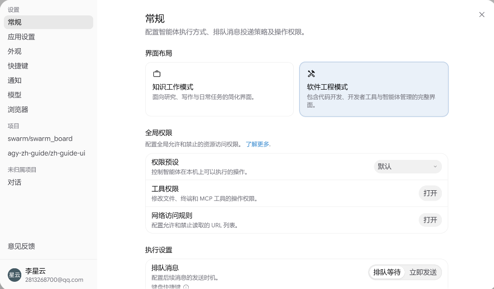

# Antigravity 2.0 中文语言切换补丁 (`antigravity-i18n-patch`)

一个**零第三方依赖**、支持**中/英文实时切换**的客户端本地化补丁工具，专为 Google Antigravity 2.0 桌面端打造。

---

## 效果预览



---

## 一、 项目解决什么问题

1. **官方界面全英文且无语言开关**：目前 Google Antigravity 2.0 桌面端（Electron 架构）的左侧导航栏、`Settings`（常规、应用设置、外观、快捷键、通知、模型、浏览器）、项目配置及反馈页面均为纯英文，未提供内置的多语言（i18n）切换选项。
2. **官方插件机制无法修改主界面**：Antigravity 的官方 Plugin / Sidecar 机制仅用于扩展 Agent 技能、MCP 工具或右侧辅助面板，没有权限修改宿主客户端的左侧菜单栏与设置界面 DOM。
3. **传统静态资源替换行不通**：Antigravity 2.0 的前端 React 界面由本地 `language_server` 动态提供，并非作为静态 HTML 存放在 `app.asar` 中，因此无法通过直接搜索替换 HTML 文件实现汉化。

**本项目的解决思路**：通过纯 Node.js 脚本解析 `resources/app.asar`，向窗口预加载脚本 `dist/preload.js` 注入一段轻量级、对 React 虚拟 DOM 无损的运行时翻译器（`MutationObserver` + 原文 `WeakMap` 缓存），从而在不破坏原有功能的前提下实现**中文显示与中/英一键切换**。

---

## 二、 主要功能

* **中 / 英文实时无损切换**：安装后默认显示简体中文；支持快捷键 **`Alt + Shift + L`** 或点击窗口右下角 **`中 / En`** 悬浮胶囊按钮随时切回英文（通过 `localStorage` 自动记忆语言偏好）。
* **全面覆盖核心设置与菜单**：内置 **300+ 条静态词条、11 条动态正则模板、7 条输入框占位提示**，覆盖主侧边栏及筛选排序菜单、对话区权限弹窗、`Settings` 全部 7 个子页面（含高级设置）、项目权限页与意见反馈页。
* **动态文本与倒计时正则翻译**：支持对包含动态数值的句子（如模型配额剩余刷新时间 `6 days, 22 hours`、`Show 4 breakdowns`、当前订阅方案名称等）进行自动匹配汉化。
* **React 安全与代码区隔离**：仅替换纯文本节点（`Text.nodeValue`）与表单提示属性（`placeholder` / `aria-label` / `title`），不增删 DOM 标签；自动跳过 `<pre>`、`<code>`、`<textarea>`、`<input>` 输入内容以及 Monaco / Xterm 代码与终端区域。
* **一键采集未翻译词条**：在任意界面按下 **`Ctrl + Shift + U`**（或右键点击右下角 **`中`** 按钮），自动扫描当前页面尚未收录的英文短句并复制为 JSON 数组到剪贴板，方便快速扩充词库。
* **零外部依赖 & 安全可逆**：内置纯 Node.js 编写的 ASAR 解包/重打包与 SHA-256 完整性重算模块，无需执行 `npm install`；首次运行自动备份原版 `app.asar.bak`，随时可通过 `restore.mjs` 100% 字节级还原。

---

## 三、 安装方法

### 1. 环境要求
* **Node.js**：`>= 18.0.0`（终端运行 `node -v` 可查看版本）
* **客户端版本**：已安装 Google Antigravity 2.0 桌面端（已在 Windows `v2.32.1` 实测通过）

### 2. 获取项目
```bash
git clone https://github.com/XXpickup/antigravity-i18n-patch.git
cd antigravity-i18n-patch
```

### 3. 退出客户端并执行安装

**Windows（PowerShell）：**
```powershell
# 确保完全关闭 Antigravity（包括后台托盘进程）
taskkill /F /IM Antigravity.exe

# 执行补丁安装（或运行 npm run patch）
node patch.mjs
```

**macOS / 自定义路径安装：**
```bash
# 如安装在默认位置可直接运行 node patch.mjs，或通过 --asar 指定路径：
node patch.mjs --asar /Applications/Antigravity.app/Contents/Resources/app.asar
```

---

## 四、 使用方法

### 1. 日常切换语言
* 启动 Antigravity 客户端后，左侧导航栏与设置页默认显示为**简体中文**。
* **切换回英文 / 中文**：
  * **方式一（鼠标）**：左键点击窗口右下角的 **`中`**（或 **`En`**）悬浮按钮。
  * **方式二（键盘）**：按快捷键 **`Alt + Shift + L`**。

### 2. 采集新页面未翻译的英文词条
如果遇到新版新增页面或未翻译的英文选项：
1. 打开对应的页面；
2. **右键点击右下角的 `中` 按钮**（或按快捷键 **`Ctrl + Shift + U`**）；
3. 右下角会弹出提示 `已复制 N 条英文词条`，此时剪贴板中即为去重后的 JSON 词条列表。

### 3. 自定义或扩充词典
1. 打开项目根目录下的 `dictionary.json`：
   * `exact`：精确匹配词条（`"英文原文": "中文译文"`）
   * `patterns`：支持正则捕获组替换的动态句式
   * `attributes`：输入框 `placeholder`、`title`、`aria-label` 属性词条
2. 保存修改后，彻底退出 Antigravity 并再次运行 `node patch.mjs` 即可更新生效。

### 4. 客户端升级后重打补丁 / 还原官方原版
* **客户端自动更新后**：官方更新会覆盖 `app.asar`，只需关闭客户端重新运行一次 `node patch.mjs` 即可。
* **卸载补丁恢复官方原版**：
  ```powershell
  taskkill /F /IM Antigravity.exe
  node restore.mjs
  ```

---

## 五、 输入输出示例

### 示例 1：安装与更新补丁（命令行输入与输出）

**首次安装输入：**
```powershell
PS C:\antigravity-i18n-patch> node patch.mjs
```

**首次安装输出：**
```text
已备份原版 app.asar -> C:\Users\<用户名>\AppData\Local\Programs\antigravity\resources\app.asar.bak
补丁应用成功！
使用说明：启动 Antigravity 后默认显示中文，按 Alt+Shift+L 或点击右下角「中 / En」按钮可随时切换语言。
```

**修改词典后再次运行（幂等更新）输出：**
```text
检测到 app.asar 已打过补丁，将基于当前版本更新注入内容...
补丁应用成功！
使用说明：启动 Antigravity 后默认显示中文，按 Alt+Shift+L 或点击右下角「中 / En」按钮可随时切换语言。
```

**还原原版输入与输出：**
```powershell
PS C:\antigravity-i18n-patch> node restore.mjs
已从备份还原原版 app.asar: ...\resources\app.asar.bak -> ...\resources\app.asar
```

---

### 示例 2：词典配置输入 vs 界面翻译输出

**输入（`dictionary.json` 片段）：**
```json
{
  "exact": {
    "Settings": "设置",
    "General": "常规",
    "Interface Layout": "界面布局",
    "Software Engineering": "软件工程模式",
    "Weekly Limit Remaining": "每周剩余额度"
  },
  "patterns": [
    {
      "regex": "^You have used some of your weekly limit, it will fully refresh in (.+)\\.$",
      "replace": "已使用部分每周额度，将在 $1 后完全刷新。",
      "translateTimeUnits": true
    },
    {
      "regex": "^Show (\\d+) breakdowns?$",
      "replace": "展开 $1 项明细"
    }
  ],
  "attributes": {
    "Search shortcuts...": "搜索快捷键..."
  }
}
```

**输出（Antigravity 界面渲染前后对比）：**

| 界面位置 | 原始英文显示（切为 `En` 时） | 补丁中文输出（切为 `中` 时） |
| :--- | :--- | :--- |
| 左侧菜单栏 | `Settings` / `General` / `Appearance` / `Models` | `设置` / `常规` / `外观` / `模型` |
| 常规设置页 | `Interface Layout` → `Software Engineering` | `界面布局` → `软件工程模式` |
| 模型配额动态倒计时 | `You have used some of your weekly limit, it will fully refresh in 6 days, 22 hours.` | `已使用部分每周额度，将在 6 天 22 小时 后完全刷新。` |
| Token 明细折叠按钮 | `Show 4 breakdowns` | `展开 4 项明细` |
| 快捷键页搜索框 `placeholder` | `Search shortcuts...` | `搜索快捷键...` |

---

### 示例 3：一键采集未翻译词条（操作输入与剪贴板输出）

* **输入操作**：在某个包含未收录英文的页面上按 **`Ctrl + Shift + U`**（或右键点击右下角 **`中`** 按钮）。
* **界面反馈**：右下角提示 `已复制 3 条英文词条`。
* **剪贴板 JSON 输出示例**：
  ```json
  [
    "Custom Experimental Feature",
    "Enable background indexing for large repositories.",
    "Rebuild Index"
  ]
  ```

---

## 六、 项目文件说明

| 文件名 | 作用说明 |
| :--- | :--- |
| `patch.mjs` | 补丁安装入口：检测进程状态、自动备份 `app.asar.bak`、合成词典并注入 `dist/preload.js` |
| `restore.mjs` | 还原入口：从 `app.asar.bak` 恢复原版或剥离注入代码块 |
| `i18n-inject.js` | 运行时前端 DOM 翻译器、原文缓存与右下角 `中 / En` 悬浮组件 |
| `dictionary.json` | 简体中文翻译词库（包含 `exact`、`patterns`、`attributes` 三部分） |
| `asar-lib.mjs` | 零依赖纯 Node.js 的 Electron ASAR 归档解析、重打包与 SHA-256 校验计算模块 |
| `cli-utils.mjs` | 跨平台（Windows / macOS / Linux）默认路径探测与运行进程检查工具 |

---

## 七、 免责声明与开源协议

* 本项目为非官方社区本地化工具，仅在用户本机修改 `resources/app.asar` 内的预加载脚本，不包含任何联网请求或数据收集行为。
* 本项目采用 [MIT License](./LICENSE) 开源，欢迎提交 Issue 或 Pull Request 共同完善词典！
